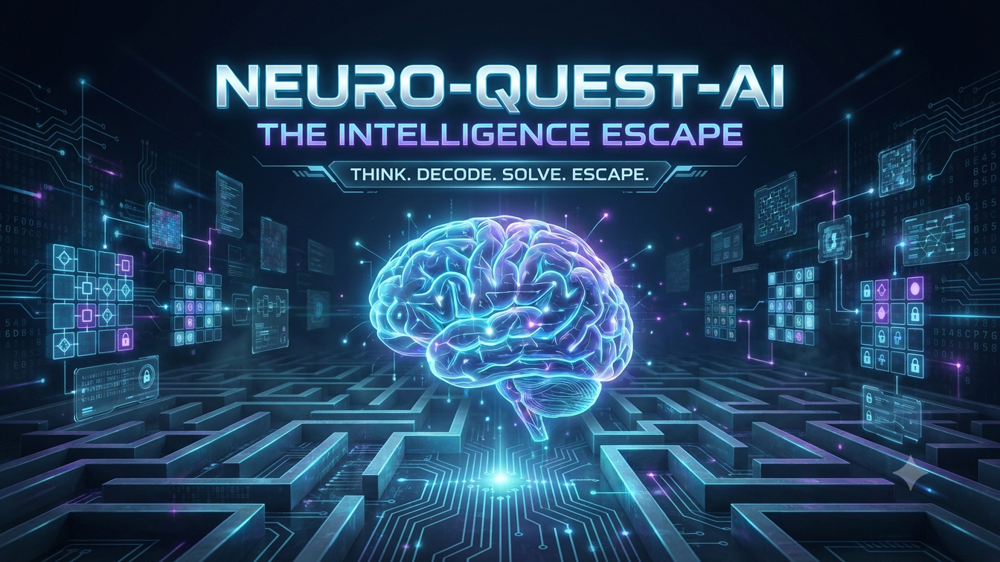
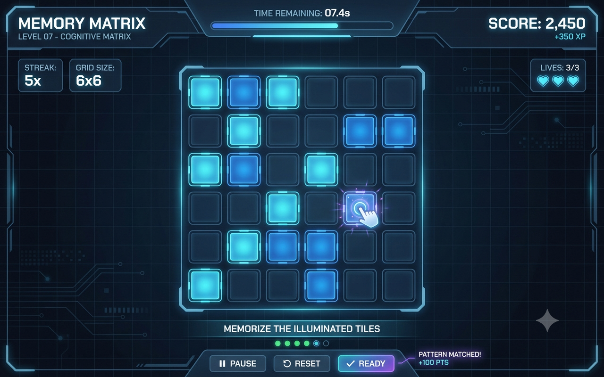
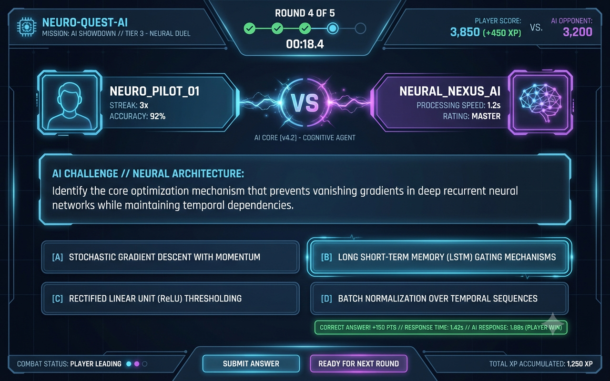
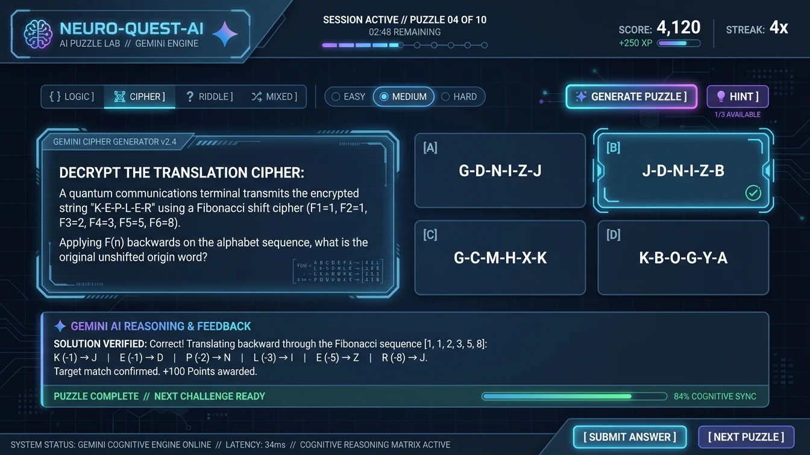

# 🧠 NEURO-QUEST-AI — THE INTELLIGENCE ESCAPE

<p align="center">
  
</p>

<p align="center">
  
</p>

<!-- CLICKABLE PROJECT BUTTONS -->
<p align="center">
  <a href="https://neuro-quest-ai.vercel.app/">
    
  </a>
  &nbsp;
  <a href="https://github.com/snehassneha4578-collab/NEURO-QUEST-AI">
    
  </a>
</p>

<!-- TECHNOLOGY BADGES -->
<p align="center">
  
  
  
  
  
</p>

---

## 🌌 EXPERIENCE THE INTELLIGENCE ESCAPE

**NEURO-QUEST-AI** is an interactive puzzle and brain-challenge platform designed to test memory, logical reasoning, problem-solving, and strategic thinking.

Explore different missions, solve challenges, track your progress, and generate new puzzles using Google's Gemini AI.

The platform combines an engaging interface, interactive gameplay, animations, and AI-powered puzzle generation to create an immersive intelligence challenge.

<p align="center">
  
</p>

<p align="center">
  <b>🧩 Think Smart • ⚡ Solve Fast • 🤖 Explore AI</b>
</p>

---

## 🎮 PLAY THE GAME

<p align="center">
  <a href="https://neuro-quest-ai.vercel.app/">
    
  </a>
</p>

**Live application:** https://neuro-quest-ai.vercel.app/

---

## 🕹️ MISSION CONTROL

The Mission Control dashboard is the central hub for exploring the available challenges and navigating the intelligence escape experience.

<p align="center">
  
</p>

### Core experience

- Interactive mission selection.
- Multiple puzzle categories.
- Animated interface elements and transitions.
- Challenge-based gameplay.
- Progress and score feedback.
- Responsive application layout.

---

## 🧠 THE FIVE CHALLENGES

The platform offers four core missions and an additional Gemini-powered AI Puzzle Lab.

### 01 — MEMORY MATRIX

Test your memory and concentration by observing patterns and recalling information.

**Challenge focus:**
- Visual memory.
- Pattern recognition.
- Concentration.
- Recall accuracy.

<p align="center">
  
</p>

### 02 — CODE BREAKER

Enter a code-solving challenge that tests logical deduction and analytical thinking.

**Challenge focus:**
- Logical reasoning.
- Pattern analysis.
- Code interpretation.
- Problem-solving.

<p align="center">
  
</p>

### 03 — LOGIC CORE

Challenge your ability to understand logical relationships and solve reasoning-based problems.

**Challenge focus:**
- Boolean logic.
- Logical operators.
- Analytical reasoning.
- Decision-making.

<p align="center">
  
</p>

### 04 — AI SHOWDOWN

Explore strategic challenges designed to test your decisions and problem-solving abilities.

**Challenge focus:**
- Strategic thinking.
- Decision-making.
- Reasoning.
- Challenge-based interaction.

<p align="center">
  
</p>

### 05 — GEMINI AI PUZZLE LAB

The AI Puzzle Lab integrates Google's Gemini API to generate new puzzles dynamically.

Instead of relying only on predefined challenges, users can request AI-generated puzzles based on their selected category and difficulty.

**Available categories:**
- Logic
- Cipher
- Riddle
- Mixed

**Difficulty levels:**
- Easy
- Medium
- Hard

**Generated puzzle content:**
- Puzzle question.
- Four answer options.
- Hint.
- Correct answer.
- Explanation.

<p align="center">
  
</p>

---

## 🤖 GEMINI AI INTEGRATION

NEURO-QUEST-AI uses the Google Gemini API to generate interactive puzzle content.

**AI model:** `gemini-3.1-flash-lite`

### How it works

1. The user selects a puzzle category.
2. The user selects a difficulty level.
3. The frontend sends a request to the backend API.
4. The backend communicates with Gemini.
5. Gemini generates the puzzle content.
6. The application displays the generated puzzle, options, hint, answer, and explanation.

### AI architecture

```text
             USER
               |
               v
       REACT FRONTEND
               |
               v
      CATEGORY & DIFFICULTY
               |
               v
       /api/generate-puzzle
               |
               v
        BACKEND API
               |
               v
         GEMINI API
      gemini-3.1-flash-lite
               |
               v
       GENERATED PUZZLE
               |
               v
       QUESTION + OPTIONS
          + HINT
          + ANSWER
          + EXPLANATION
               |
               v
       INTERACTIVE UI
```

### API endpoint

```http
POST /api/generate-puzzle
```

The Gemini API key is configured as a sensitive environment variable on the deployment platform. It is not intended to be exposed in frontend code or committed to the repository.

---

## ✨ KEY FEATURES

| Feature | Description |
|---|---|
| Interactive Missions | Four core challenge experiences |
| AI Puzzle Lab | Dynamically generated puzzles |
| Gemini Integration | AI-powered puzzle generation |
| Multiple Categories | Logic, Cipher, Riddle, Mixed |
| Difficulty Selection | Easy, Medium, Hard |
| Puzzle Hints | Hints for generated challenges |
| Answer Explanations | Explanations for generated answers |
| Animations | Animated interface and transitions |
| Responsive UI | Designed for different screen sizes |
| Local Storage | Browser-based persistence where implemented |

---

## 🛠️ TECHNOLOGY STACK

### Frontend

- React 19
- TypeScript 7
- Vite 8
- CSS
- Framer Motion
- Lucide React

### Backend and AI

- Node.js API runtime
- Google Gemini API
- Gemini 3.1 Flash-Lite

### Deployment and Tools

- Vercel
- Git
- GitHub
- npm

---

## 🏗️ PROJECT STRUCTURE

```text
NEURO-QUEST-AI/
│
├── api/
│   └── generate-puzzle.ts
│
├── docs/
│   └── images/
│       ├── neuro-quest-hero.png
│       ├── mission-control.png
│       ├── memory-matrix.png
│       ├── codebreaker-logic-core.png
│       ├── ai-showdown.png
│       └── ai-puzzle-lab.png
│
├── src/
│   ├── App.tsx
│   ├── App.css
│   └── ...
│
├── index.html
├── package.json
├── tsconfig.json
├── tsconfig.api.json
├── vite.config.ts
├── vercel.json
└── README.md
```

---

## 🚀 RUN LOCALLY

Follow these steps to run NEURO-QUEST-AI on your computer.

### 1. Clone the repository

```bash
git clone https://github.com/snehassneha4578-collab/NEURO-QUEST-AI.git
```

### 2. Open the project

```bash
cd NEURO-QUEST-AI
```

### 3. Install dependencies

```bash
npm install
```

### 4. Configure the Gemini API key

Create a `.env.local` file in the project root:

```env
GEMINI_API_KEY=YOUR_GEMINI_API_KEY
```

Replace the placeholder with your own API key. Never commit this file or expose the key in frontend code.

### 5. Start the development environment

```bash
npm run dev
```

Open the local URL displayed in the terminal.

### 6. Run with Vercel locally

For testing the backend API together with the frontend, use:

```bash
vercel dev
```

Ensure the required environment variable is configured in your local environment.

---

## 🔐 SECURITY

- Gemini API credentials are stored as environment variables.
- API credentials should never be hardcoded in frontend code.
- `.env.local` should not be committed to GitHub.
- AI requests are handled through the backend API endpoint.
- Production secrets are configured through Vercel environment settings.

---

## 🧪 TESTING AND VERIFICATION

The following checks have been completed during development:

| Check | Verified result |
|---|---|
| ESLint | Passed — zero warnings and errors |
| Production build | Passed |
| TypeScript build checks | Passed |
| Git diff check | Passed |
| Production AI API | HTTP 200 response |
| Generated puzzle structure | Validated |
| Browser gameplay | Core missions and AI Puzzle Lab tested |

---

## ☁️ DEPLOYMENT

The application is deployed using Vercel.

<p align="center">
  <a href="https://neuro-quest-ai.vercel.app/">
    
  </a>
</p>

**Production URL:** https://neuro-quest-ai.vercel.app/

**Repository:** https://github.com/snehassneha4578-collab/NEURO-QUEST-AI

---

## 🔮 FUTURE ENHANCEMENTS

Potential directions for future development:

- Additional intelligence missions.
- More AI-generated puzzle categories.
- Expanded difficulty levels.
- Enhanced player statistics and progress tracking.
- Leaderboards and achievements.
- Additional sound and animation effects.
- More personalized challenge experiences.
- Improved accessibility and mobile interactions.

---

## 🎯 PROJECT OBJECTIVE

NEURO-QUEST-AI brings together interactive gameplay, logical reasoning, and generative AI in one application.

It demonstrates how modern frontend technologies and AI integration can be combined to create an engaging, interactive puzzle platform.

**Think beyond the obvious. Challenge your intelligence. Escape the ordinary.**

---

<p align="center">
  
</p>

<p align="center">
  <b>🧠 NEURO-QUEST-AI</b><br/>
  <i>THE INTELLIGENCE ESCAPE</i><br/><br/>
  <a href="https://neuro-quest-ai.vercel.app/">PLAY THE GAME</a>
  &nbsp; • &nbsp;
  <a href="https://github.com/snehassneha4578-collab/NEURO-QUEST-AI">VIEW SOURCE CODE</a>
</p>
