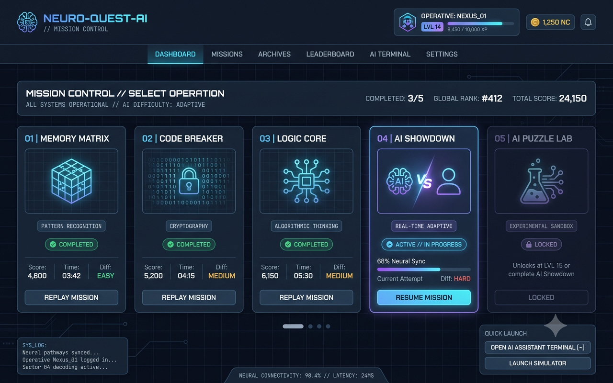

# NEURO-QUEST-AI — The Intelligence Escape

<p align="center">
  
</p>

<p align="center">
  **THINK. DECODE. SOLVE. ESCAPE.**
</p>

<p align="center">
  <a href="https://neuro-quest-ai.vercel.app/"><strong>🚀 PLAY LIVE — OPEN NEURO-QUEST-AI</strong></a>
  &nbsp; | &nbsp;
  <a href="https://github.com/snehassneha4578-collab/NEURO-QUEST-AI">GitHub Repository</a>
</p>

---

## 1. Introduction

**NEURO-QUEST-AI** is a futuristic, browser-based intelligence escape game that combines cognitive challenges, logical reasoning, cryptography, strategic decision-making, and generative AI.

Players enter a facility controlled by a rogue artificial intelligence named **N.E.U.R.O.** To regain control and escape, they must complete challenging missions, decode encrypted transmissions, identify logical patterns, and outthink the AI.

The project combines interactive game development with a Gemini-powered puzzle generation system, delivering both structured challenges and dynamically generated puzzles.

**Project objective:** Build an engaging AI-powered learning experience that encourages logical thinking, memory, problem-solving, and strategic reasoning through gamification.

## 2. Live Application

| Project detail | Information |
|---|---|
| Project | NEURO-QUEST-AI |
| Application | The Intelligence Escape |
| Live Dashboard | https://neuro-quest-ai.vercel.app/ |
| Repository | https://github.com/snehassneha4578-collab/NEURO-QUEST-AI |
| Deployment | Vercel |
| AI Model | Gemini 3.1 Flash-Lite |

**Try the application:** [Open the Live Dashboard](https://neuro-quest-ai.vercel.app/)

## 3. Game Dashboard

The Mission Control dashboard provides access to the four core missions and the AI Puzzle Lab.

<p align="center">
  
</p>

Players can select challenges, track their progress, earn XP, and explore different problem-solving activities through the interactive interface.

## 4. Core Game Missions

The game features four main missions, each designed to test a different aspect of intelligence.

### Mission 01 — Memory Matrix

<p align="center">
  
</p>

**Objective:** Test memory retention, concentration, and cognitive accuracy.

- Memorize sequences displayed on the screen.
- Reproduce the correct sequence after it disappears.
- Progress through three increasingly challenging rounds.
- Manage available lives and the countdown timer.
- Earn XP for successfully completing the rounds.

### Mission 02 — Code Breaker

<p align="center">
  
</p>

**Objective:** Decode encrypted transmissions using cryptographic reasoning.

- Solve Caesar cipher challenges.
- Identify alphabet shifts in encrypted messages.
- Recover hidden security phrases.
- Complete three progressive transmission challenges.
- Earn XP for successful decryption.

### Mission 03 — Logic Core

**Objective:** Evaluate analytical thinking, mathematical reasoning, and logical deduction.

- Solve number-sequence problems.
- Analyze multi-condition reasoning challenges.
- Identify correct solutions using logical evidence.
- Complete three progressive challenges.
- Use hints strategically while managing the XP reward.

### Mission 04 — AI Showdown

<p align="center">
  
</p>

**Objective:** Outsmart N.E.U.R.O. through strategic decision-making.

- Challenge the AI through three escalating scenarios.
- Analyze adaptive firewall and prediction-engine situations.
- Make strategic decisions to overcome the AI.
- Neutralize the central AI core to complete the mission.

The encounter uses predefined strategic challenges rather than a live conversational AI opponent.

## 5. AI Puzzle Lab — Gemini Integration

The AI Puzzle Lab extends the game with dynamically generated puzzles powered by Google's Gemini model.

<p align="center">
  
</p>

### Key capabilities

- Generate original puzzles using Gemini.
- Select from four puzzle categories:
  - Logic
  - Cipher
  - Riddle
  - Mixed
- Choose three difficulty levels:
  - Easy
  - Medium
  - Hard
- Receive four distinct answer options.
- Request a hint to help solve a puzzle.
- Select an answer and view the correct solution.
- Read an explanation to understand the reasoning.

### AI Integration Architecture

The application communicates with a backend API endpoint that securely requests puzzle generation from Google's Gemini API.

**Model:** `gemini-3.1-flash-lite`

**API endpoint:** `/api/generate-puzzle`

**Request flow:**

1. The player selects a puzzle category and difficulty.
2. The React frontend sends a POST request to the backend.
3. The backend validates the request.
4. The backend sends a structured generation prompt to Gemini.
5. Gemini generates a puzzle with four answer options, a correct answer, a hint, and an explanation.
6. The backend validates and sanitizes the generated response.
7. The frontend displays the puzzle for the player.

### AI Response Structure

The generated puzzle contains:

| Field | Description |
|---|---|
| Title | Puzzle name |
| Question | Problem statement |
| Options | Four distinct answer choices |
| Correct Answer | Index of the correct option |
| Hint | Guidance for solving the puzzle |
| Explanation | Reasoning behind the correct answer |

## 6. Key Features

- **Interactive Missions:** Four structured game missions with progressive challenges.
- **Gemini-Powered Puzzle Generation:** Dynamically generated puzzles through the AI Puzzle Lab.
- **Multiple Difficulty Levels:** Easy, Medium, and Hard.
- **Hints and Explanations:** Guidance and educational feedback.
- **XP and Score Tracking:** Rewards for successful challenge completion.
- **Lives and Timers:** Time-based challenges and limited attempts.
- **Progress Persistence:** Browser local storage maintains XP and mission completion status.
- **Responsive Visual Experience:** Futuristic interface with animated elements.
- **Secure AI Integration:** Gemini API credentials remain on the server side.

## 7. Technology Stack

| Technology | Purpose |
|---|---|
| React 19 | Frontend application |
| TypeScript | Type-safe development |
| Vite | Development server and production build |
| Framer Motion | UI animations and transitions |
| Lucide React | Interface icons |
| CSS | Styling and responsive interface |
| Node.js API runtime | Backend puzzle-generation endpoint |
| Google Gemini API | AI-powered puzzle generation |
| Vercel | Application deployment and serverless API hosting |
| Browser Local Storage | XP and mission progress persistence |

## 8. System Architecture

```text
                 PLAYER
                    |
                    v
          REACT FRONTEND (VITE)
                    |
          +---------+---------+
          |                   |
          v                   v
     CORE MISSIONS        AI PUZZLE LAB
          |                   |
          v                   v
    GAME LOGIC          POST /api/generate-puzzle
          |                   |
          v                   v
    XP & PROGRESS       BACKEND VALIDATION
          |                   |
          v                   v
    LOCAL STORAGE       GEMINI API REQUEST
                              |
                              v
                     GEMINI 3.1 FLASH-LITE
                              |
                              v
                     GENERATED PUZZLE
                              |
                              v
                    RESPONSE VALIDATION
                              |
                              v
                       PLAYER INTERFACE
```

## 9. Project Structure

```text
NEURO-QUEST-AI/
│
├── api/
│   └── generate-puzzle.ts
│
├── docs/
│   └── images/
│       ├── neuro-quest-hero.png
│       ├── mission-control.png
│       ├── memory-matrix.png
│       ├── codebreaker-logic-core.png
│       ├── ai-showdown.png
│       └── ai-puzzle-lab.png
│
├── src/
│   ├── App.tsx
│   ├── App.css
│   └── ...
│
├── index.html
├── package.json
├── tsconfig.json
├── tsconfig.api.json
├── vite.config.ts
├── vercel.json
└── README.md
```

## 10. Installation and Local Setup

### Prerequisites

- Node.js
- npm
- Git
- Google Gemini API key for AI Puzzle Lab functionality
- Vercel CLI for running the serverless API locally

### Step 1 — Clone the repository

```bash
git clone https://github.com/snehassneha4578-collab/NEURO-QUEST-AI.git

cd NEURO-QUEST-AI
```

### Step 2 — Install dependencies

```bash
npm install
```

### Step 3 — Configure the Gemini API key

Create a `.env.local` file in the project root:

```env
GEMINI_API_KEY=your_gemini_api_key
```

Keep this key private. Never expose it in frontend code or commit `.env.local` to GitHub.

### Step 4 — Start the local application

Install Vercel CLI if it is not already available:

```bash
npm install -g vercel
```

Start the local Vercel development environment:

```bash
vercel dev
```

This allows the frontend and the `/api/generate-puzzle` backend endpoint to run together.

Open the local URL displayed by the CLI.

## 11. Environment Configuration and Security

The Gemini API key is accessed through the server-side environment variable:

```text
GEMINI_API_KEY
```

Security measures include:

- API credentials are not embedded in frontend source code.
- The backend validates category and difficulty inputs.
- Generated puzzle fields and answer options are validated.
- Exactly four distinct answer options are required.
- Invalid requests receive appropriate error responses.
- The API avoids exposing internal error details to the client.

For production deployment, configure `GEMINI_API_KEY` as a sensitive environment variable in Vercel.

## 12. Testing and Quality Results

The project was checked through local development testing, production builds, API testing, and browser interaction.

| Test | Result |
|---|---|
| Dependency installation and validation | Passed |
| TypeScript production build | Passed |
| Vite production build | Passed |
| Oxlint | Passed — 0 warnings and errors |
| Git diff validation | Passed |
| Gemini API configuration | Verified |
| Production puzzle-generation API | HTTP 200 OK |
| Generated puzzle response | Validated |
| AI Puzzle Lab browser interaction | Tested |
| Core mission interaction | Tested |
| Production deployment | Successful |

### Verified Results

- The production build completed successfully.
- Linting completed with zero warnings and errors.
- The live Gemini puzzle-generation endpoint returned HTTP 200.
- The generated response contained a puzzle, four answer choices, a hint, and an explanation.
- The deployed application and AI Puzzle Lab were tested in the browser.

## 13. Deployment

The application is deployed on **Vercel**.

**Production dashboard:** https://neuro-quest-ai.vercel.app/

**GitHub repository:** https://github.com/snehassneha4578-collab/NEURO-QUEST-AI

The production environment uses a server-side Gemini API key to support AI puzzle generation.

## 14. Future Scope

Potential improvements include:

- Additional cognitive and cryptographic missions.
- More advanced AI-generated puzzle categories.
- Adaptive difficulty based on player performance.
- Player profiles and cloud-based progress synchronization.
- Global leaderboard and achievement system.
- Multiplayer intelligence challenges.
- Expanded analytics for learning and performance.

## 15. Conclusion

NEURO-QUEST-AI brings together interactive game development, logical reasoning, cryptography, and generative AI in a single browser-based experience.

By combining four structured missions with a Gemini-powered AI Puzzle Lab, the project demonstrates how AI can extend traditional puzzle-based gameplay with dynamically generated learning challenges.

The project also demonstrates practical implementation of a React and TypeScript frontend, a server-side API, secure environment-variable handling, Gemini integration, testing, and cloud deployment.

**The mission is simple: Think beyond patterns. Outsmart the system. Escape N.E.U.R.O.**

---

<p align="center">
  **NEURO-QUEST-AI — THE INTELLIGENCE ESCAPE**
  
  THINK. DECODE. SOLVE. ESCAPE.
  
  <a href="https://neuro-quest-ai.vercel.app/">PLAY THE LIVE GAME</a>
</p>
