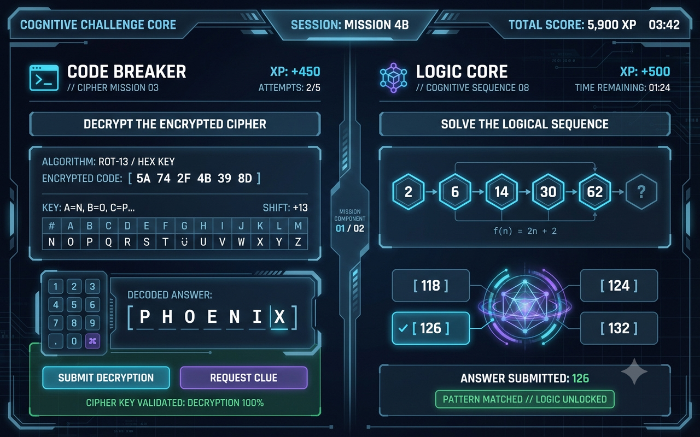

# 🧠 NEURO-QUEST-AI
## THE INTELLIGENCE ESCAPE

<p align="center">
  <strong>Think Smart. Solve Fast. Challenge Your Intelligence.</strong>
</p>

<p align="center">
  <a href="https://neuro-quest-ai.vercel.app/">🚀 PLAY LIVE GAME</a>
  &nbsp; | &nbsp;
  <a href="https://github.com/snehassneha4578-collab/NEURO-QUEST-AI">⭐ VIEW GITHUB REPOSITORY</a>
</p>

---

## 🌌 ABOUT THE PROJECT

**NEURO-QUEST-AI — The Intelligence Escape** is an interactive puzzle and brain-challenge platform designed to test memory, logical reasoning, analytical thinking, and problem-solving abilities.

The application combines interactive missions, engaging visual effects, and Google's Gemini AI to create an intelligence-based gaming experience.

Users can explore different challenges, solve puzzles, and generate new puzzles dynamically using the AI Puzzle Lab.


---

## 🎮 LIVE APPLICATION

**Play here:** https://neuro-quest-ai.vercel.app/

**GitHub repository:** https://github.com/snehassneha4578-collab/NEURO-QUEST-AI

---

## 🕹️ MISSION CONTROL

Mission Control is the main dashboard for navigating the intelligence challenges.

Features include:
- Interactive mission selection.
- Multiple puzzle experiences.
- Challenge-based gameplay.
- Score and progress feedback.
- Animated interface transitions.
- Responsive user interface.


---

## 🧠 THE FIVE CHALLENGES

### 01. MEMORY MATRIX

Test your memory and concentration by observing patterns and recalling information.

**Challenge areas:**
- Visual memory.
- Pattern recognition.
- Concentration.
- Recall accuracy.


### 02. CODE BREAKER

Solve code-based challenges using logical deduction and analytical thinking.

**Challenge areas:**
- Logical reasoning.
- Pattern analysis.
- Code interpretation.
- Problem-solving.



### 03. LOGIC CORE

Explore reasoning-based challenges involving logical relationships and problem-solving.

**Challenge areas:**
- Boolean logic.
- Logical operators.
- Analytical reasoning.
- Decision-making.


### 04. AI SHOWDOWN

Take on strategic challenges designed to test your reasoning and decision-making abilities.

**Challenge areas:**
- Strategic thinking.
- Decision-making.
- Reasoning.
- Problem-solving.


### 05. GEMINI AI PUZZLE LAB

The AI Puzzle Lab uses Google's Gemini API to dynamically generate puzzles.

Users can select a category and difficulty level to generate new challenges.

**Puzzle categories:**
- Logic
- Cipher
- Riddle
- Mixed

**Difficulty levels:**
- Easy
- Medium
- Hard

**Generated content:**
- Puzzle question.
- Four answer options.
- Hint.
- Correct answer.
- Explanation.


---

## 🤖 GOOGLE GEMINI AI INTEGRATION

NEURO-QUEST-AI integrates Google's Gemini API for dynamic puzzle generation.

**Model:** `gemini-3.1-flash-lite`

### How it works

1. The user selects a puzzle category.
2. The user chooses a difficulty level.
3. The frontend sends a request to the backend.
4. The backend communicates with the Gemini API.
5. Gemini generates the puzzle content.
6. The application displays the question, options, hint, answer, and explanation.

### AI workflow

```text
USER
  |
  v
REACT FRONTEND
  |
  v
CATEGORY AND DIFFICULTY
  |
  v
/api/generate-puzzle
  |
  v
BACKEND API
  |
  v
GOOGLE GEMINI API
  |
  v
GENERATED PUZZLE
  |
  v
QUESTION + OPTIONS + HINT
  + ANSWER + EXPLANATION
  |
  v
INTERACTIVE USER INTERFACE
```

### API endpoint

`POST /api/generate-puzzle`

The Gemini API key is stored as a sensitive environment variable and handled through the backend.

---

## ✨ KEY FEATURES

| Feature | Description |
|---|---|
| Interactive Missions | Four core intelligence challenges |
| Gemini AI Puzzle Lab | Dynamically generated puzzles |
| Multiple Categories | Logic, Cipher, Riddle, Mixed |
| Difficulty Selection | Easy, Medium, Hard |
| Puzzle Hints | Hints for generated puzzles |
| Answer Explanations | Explanations for generated answers |
| Animations | Interface animations and transitions |
| Responsive Design | Layout for different screen sizes |
| Local Storage | Browser-based persistence where implemented |

---

## 🛠️ TECHNOLOGY STACK

### Frontend
- React 19
- TypeScript 7
- Vite 8
- CSS
- Framer Motion
- Lucide React

### Backend and AI
- Node.js API runtime
- Google Gemini API
- Gemini 3.1 Flash-Lite

### Development and Deployment
- Git
- GitHub
- npm
- Vercel

---

## 🏗️ PROJECT STRUCTURE

```text
NEURO-QUEST-AI/
│
├── api/
│   └── generate-puzzle.ts
│
├── docs/
│   └── images/
│       ├── neuro-quest-hero.png
│       ├── mission-control.png
│       ├── memory-matrix.png
│       ├── codebreaker-logic-core.png
│       ├── ai-showdown.png
│       └── ai-puzzle-lab.png
│
├── src/
│   ├── App.tsx
│   ├── App.css
│   └── ...
│
├── index.html
├── package.json
├── tsconfig.json
├── vite.config.ts
├── vercel.json
└── README.md
```

---

## 🚀 RUN LOCALLY

### 1. Clone the repository

```bash
git clone https://github.com/snehassneha4578-collab/NEURO-QUEST-AI.git
```

### 2. Navigate to the project

```bash
cd NEURO-QUEST-AI
```

### 3. Install dependencies

```bash
npm install
```

### 4. Configure the Gemini API key

Create a `.env.local` file in the project root:

```env
GEMINI_API_KEY=YOUR_GEMINI_API_KEY
```

Replace the placeholder with your actual Gemini API key.

Never expose your API key in frontend code or commit `.env.local` to GitHub.

### 5. Start the frontend development server

```bash
npm run dev
```

### 6. Run the application with Vercel locally

```bash
vercel dev
```

This allows you to test the frontend and backend API together.

---

## 🔐 SECURITY

- API credentials are stored in environment variables.
- Gemini API requests are handled through the backend.
- API keys should never be exposed in frontend code.
- Local environment files should not be committed.
- Production secrets are configured through Vercel.

---

## 🧪 TESTING AND VERIFICATION

Development checks completed:

| Test | Result |
|---|---|
| ESLint | Passed — zero warnings and errors |
| Production build | Passed |
| TypeScript checks | Passed |
| Git diff check | Passed |
| Production AI API | HTTP 200 verified |
| Generated puzzle structure | Validated |
| Browser gameplay | Core missions and AI Puzzle Lab tested |

---

## ☁️ DEPLOYMENT

The application is deployed on Vercel.

**Live application:** https://neuro-quest-ai.vercel.app/

**Source code:** https://github.com/snehassneha4578-collab/NEURO-QUEST-AI

---

## 🔮 FUTURE ENHANCEMENTS

- Additional intelligence missions.
- More AI-generated puzzle categories.
- Expanded difficulty levels.
- Player statistics and progress tracking.
- Leaderboards and achievements.
- Additional sound and animation effects.
- More personalized puzzle experiences.
- Improved accessibility and mobile interactions.

---

## 🎯 PROJECT VISION

NEURO-QUEST-AI explores how interactive gameplay and generative AI can be combined to create engaging problem-solving experiences.

It brings together frontend development, backend API integration, and AI-powered content generation in one application.

**Think beyond the obvious. Challenge your intelligence. Escape the ordinary.**

---

<p align="center">
  <strong>🧠 NEURO-QUEST-AI</strong><br/>
  THE INTELLIGENCE ESCAPE
  <br/><br/>
  <a href="https://neuro-quest-ai.vercel.app/">🚀 PLAY LIVE</a>
  &nbsp; | &nbsp;
  <a href="https://github.com/snehassneha4578-collab/NEURO-QUEST-AI">⭐ GITHUB</a>
</p>
